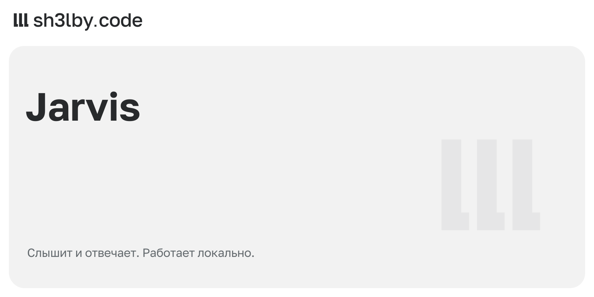

# Jarvis

<!-- portfolio-card:start -->
[](docs/portfolio/card.svg)
<!-- portfolio-card:end -->

Открыть приложение голосом, не отправляя речь в облачный сервис. Jarvis слушает микрофон на Linux, распознаёт русские команды локально и отвечает синтезированным голосом. Запускать он может только приложения из заранее заданного списка.

Проект объединяет полный путь голосовой команды: захват звука, выделение фразы, распознавание, действие и ответ. После установки моделей распознавание и озвучивание работают офлайн.

## Что происходит после команды

`ffmpeg` получает звук через PipeWire или PulseAudio, `webrtcvad` выделяет речь, Vosk распознаёт фразу. Для ответа используется Piper, с резервным голосом через `spd-say`. Приложение запускается или получает фокус через `wmctrl`.

Ассистентом можно управлять через Unix socket и системный трей на `yad`: приостановить прослушивание, продолжить работу или перечитать настройки. Команда `doctor` помогает проверить локальное окружение перед запуском.

Обсудить похожий проект: [sh3l.beer](https://sh3l.beer).

## Быстрый старт

1. Установите Python-зависимости:

```bash
python3 -m venv .venv
.venv/bin/python -m pip install -e .
```

2. Скачайте русскую модель Vosk и распакуйте её в `data/models/vosk-ru`.

3. Скачайте голос `Piper`:

```bash
.venv/bin/python -m piper.download_voices --data-dir data/voices/piper ru_RU-irina-medium
```

4. При необходимости отредактируйте `config/settings.toml` и `config/apps.toml`.

5. Проверьте окружение:

```bash
.venv/bin/python -m jarvis doctor
```

6. Запустите ассистента:

```bash
.venv/bin/python -m jarvis run
```

## Команды

```bash
.venv/bin/python -m jarvis run
.venv/bin/python -m jarvis doctor
.venv/bin/python -m jarvis list-devices
.venv/bin/python -m jarvis ctl status
.venv/bin/python -m jarvis ctl pause
.venv/bin/python -m jarvis ctl resume
.venv/bin/python -m jarvis ctl reload
.venv/bin/python -m jarvis ctl stop
.venv/bin/python -m jarvis tray
```

## Конфигурация

- [config/settings.toml](config/settings.toml)
- [config/apps.toml](config/apps.toml)
